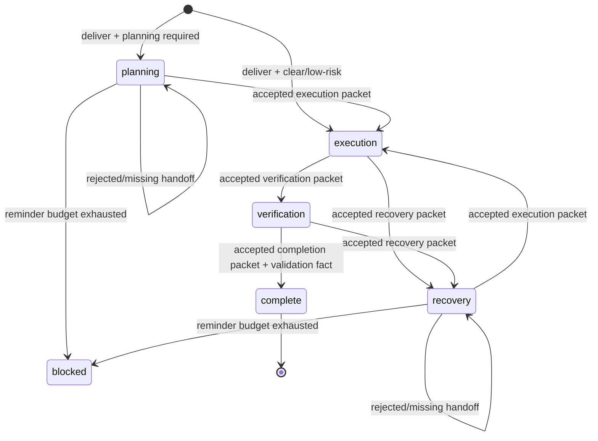

# 阶段编排模型路由设计

状态：设计草案，基于已确认的 [需求](requirements.md)。

## 概述

`phase-orchestrated-routing` 在现有 `gears/auto` virtual model 上增加一个可选工作流控制层。它将单条**交付型**用户请求拆为受控阶段，而不是让每个 physical model 自由决定何时降档：

```text
planning (high capability, read-only)
  -- accepted handoff --> execution (economical implementation)
  -- accepted handoff --> verification (economical verification)
  -- accepted handoff --> recovery (high capability, read-only)
  -- accepted handoff --> complete
```

核心约束：

- **普通 continuation/retry 不换模型**；只有接受的 handoff 才能打破同一 agent run 内的 sticky dispatch。
- **planning/recovery 默认只读**，由 `tool_call` 拦截强制执行，不能仅依赖 prompt。
- **模型不能单方面降档**。它只能提交结构化 packet；本地校验与 Jev readiness 判定共同决定是否接受。
- **Jev 是分类器，不是 workflow coordinator**；不引入第二个聊天模型、数据库或外部工作流服务。
- 与跨模型 prompt/KV cache 的可复用性无关；每次接受的阶段切换显式接受一次 cold-cache 成本。

v1 是 opt-in，默认 `workflow.enabled: false`，以保证当前 task-aware routing 的行为不变。

## Pi 运行时事实与设计后果

| Pi 事实 | 设计后果 |
|---|---|
| virtual model 的 `route()` 在每次 provider request 前运行；它可返回 JSON state。 | `route()` 是模型/effort 的唯一选择点，阶段状态应由纯 reducer 推导。 |
| `route()` 对 `continuation` 返回上一 physical pair 是推荐 cache/thinking-safe 语义。 | 除“接受 handoff 后的首个 continuation”外，保持现有 sticky 逻辑。 |
| Tool result 会进入下一 continuation 的消息；custom tool 可有 `structuredContent`。 | handoff tool 产出可验证的结构化结果；下一次 route 才消费它。 |
| virtual state 在 request 发送前写入；tool 与 `agent_before_settle` 在之后异步运行。 | handoff/reminder/blocked 还必须写为 append-only custom branch entry，不能试图就地修改先前 virtual state。 |
| `agent_before_settle` 可追加 custom/custom_message entry 且请求一次 continuation。 | 漏掉 handoff 时仅用此点追加一次提醒；状态依据 branch entry 重建，避免内存态丢失。 |
| `tool_call` 可以阻止模型工具调用，且所有工具（含 nested）都会触发。 | 在 planning/recovery 强制只读；未知工具默认拒绝，防止通过新工具绕过。 |
| `context_with_system` 可以为请求变换完整 LLM 消息。 | 每个阶段注入稳定、由 extension 生成的 phase instruction 和当前已接受 packet；同阶段文本保持不变，避免无谓 cache churn。 |

来源：本机 Pi 的 `virtual-models.md`、`extensions.md`、`extensions/types.d.ts` 和官方 `examples/extensions/jev-router.ts`。官方 Jev 示例仅以“首次 edit/write”作为切换条件；本设计采用显式受验证 packet，故不复制该策略。

## 架构

```mermaid
flowchart TD
  U[用户消息] --> R[gears/auto route]
  R -->|workflow disabled/不适用| T[现有 task-aware routing]
  R -->|deliver + planning|required| P[planning profile\nheavy/high+]
  R -->|deliver + clear/low risk| E[execution profile\nstandard/medium+]

  P --> G[只读工具守卫]
  G --> H[gear_workflow_handoff]
  H --> L[本地 packet 校验]
  L --> J[Jev handoff readiness]
  J -->|accepted custom event| C[下一 handoff continuation]
  J -->|rejected| P
  C --> E

  E --> V[verification profile]
  E -->|recovery handoff| X[recovery profile\nheavy/high+]
  V -->|recovery handoff| X
  X --> G
  V -->|completion handoff| F[complete]

  P -->|自然结束且无 handoff| M[agent_before_settle\n一次提醒]
  M --> P
  M -->|再次无 handoff| B[blocked]
```

组件分层：

1. **Workflow classifier**：在新用户回合识别交付意图、当前任务关系、建议起始阶段、复杂度、风险与清晰度。
2. **Workflow reducer**：纯函数；将旧状态、branch event、用户判定和配置转换为 phase、目标能力区间与是否允许自动 continuation。
3. **Handoff tool**：模型显式提交结构化 packet；做本地 schema/状态校验，并发起一次 Jev readiness 分类。
4. **Branch event store**：追加 accepted/rejected handoff、reminder、blocked、validation fact；负责 tool/lifecycle 与下一 route 间的可靠传递。
5. **Route adapter**：在既有 `src/index.ts` 的 physical target 解析之上，优先消费已接受 handoff，之后才执行 ordinary sticky 或用户回合判断。
6. **Phase safety layer**：`tool_call` 只读保护、`context_with_system` phase instructions、`agent_before_settle` 一次提醒、TUI status。

## 状态模型

### `GearState` 扩展

保留现有 `task?: TaskState`、`dispatch` 和 `decision`。新增可选 `workflow?: WorkflowState`；workflow 关闭或无法安全建立时不写入该字段。

```ts
type WorkflowObjective =
  | "deliver"
  | "plan_only"
  | "research_only"
  | "review"
  | "question";

type WorkflowPhase =
  | "planning"
  | "execution"
  | "verification"
  | "recovery"
  | "complete"
  | "blocked";

type WorkflowProfile = "planning" | "execution" | "verification" | "recovery";

interface WorkflowState {
  version: 1;
  workflowId: string;             // `workflow:${initialUserTurnId}`
  objective: WorkflowObjective;
  phase: WorkflowPhase;
  activeProfile: WorkflowProfile | undefined;
  initialTurnId: string;
  transitionCount: number;
  reminderCount: number;          // 折叠当前 branch 的 reminder event 后所得
  consumedHandoffIds: string[];  // 最多 8 个，防止旧 packet 再次触发
  activePacket?: ActivePacket;    // 仅最近接受且当前 phase 所需的有界 packet
  lastTransition?: TransitionTrace;
  policyFingerprint: string;
}

interface ActivePacket {
  handoffId: string;
  from: WorkflowPhase;
  to: WorkflowPhase;
  digest: string;
  packet: WorkflowPacket;
  readinessConfidence?: number;
}

interface TransitionTrace {
  handoffId?: string;
  from?: WorkflowPhase;
  to: WorkflowPhase;
  reason: "initial" | "accepted-handoff" | "user-superseded" | "budget-exhausted" | "blocked";
  requestedBand?: Band;
}
```

所有 string、数组、packet 和总 JSON 字节数都由 `validWorkflowState()` 设上限；无效或未知版本不参与自动编排。旧 `GearState` 仍可用于同轮 physical dispatch，但不会被自动解释为 workflow。

### Append-only branch event

virtual state 无法由 tool/lifecycle 直接原地更新。因此写入不可变 custom entries，并在后续 route / status 重建为 effective workflow facts：

```ts
const WORKFLOW_EVENT_TYPE = "pi-gear-router.workflow";

type WorkflowEvent =
  | {
      version: 1;
      kind: "accepted-handoff";
      workflowId: string;
      sourceTurnId: string;
      handoffId: string;
      from: "planning" | "execution" | "verification" | "recovery";
      to: "execution" | "verification" | "recovery" | "complete";
      packet: WorkflowPacket;
      packetDigest: string;
      readinessConfidence: number;
      requestedBand: Band;
    }
  | {
      version: 1;
      kind: "handoff-rejected";
      workflowId: string;
      sourceTurnId: string;
      from: WorkflowPhase;
      to: WorkflowPhase;
      reason: string;             // 已截断的安全诊断
    }
  | {
      version: 1;
      kind: "reminder" | "blocked";
      workflowId: string;
      phase: "planning" | "recovery";
      sourceTurnId: string;
    }
  | {
      version: 1;
      kind: "validation";
      workflowId: string;
      sourceTurnId: string;
      outcome: "passed" | "failed";
      commandKind: string;        // 白名单类别，而不是完整命令或输出
    };
```

设计原则：

- `accepted-handoff` 由 extension tool 生成，route **绝不**只信任模型文本或伪造的 tool-looking message。
- `sourceTurnId` 必须匹配当前 workflow 的 initial user turn；因而用户在手动 follow-up 中优先于尚未启动的旧 handoff。
- `handoffId` 由 workflow ID、真实 tool call ID、packet digest 和来源阶段派生；route 消费后写入 `consumedHandoffIds`。
- event 只随当前 branch 读取；不扫描 abandoned branches。
- `blocked` 让 reload/resume/tree 后仍能恢复状态栏；下一真实用户回合可建立新的 workflow 或显式改写旧 workflow。

## Packet 与 handoff tool

### Tool 入口

注册常驻、direct 的模型工具：

```text
gear_workflow_handoff
```

工具设置 `executionMode: "sequential"`，避免 handoff validation 与同一批工具调用并发地修改 workflow records。它不是写工作区的工具，标记 `readOnlyHint: true`、`idempotentHint: false`。

当前 phase 从 latest valid `GearState.workflow` 读取；调用方不传 `from`，以免伪造转换起点。可选 `to` 的合法边为：

| 当前 phase | 允许 `to` |
|---|---|
| `planning` | `execution` |
| `execution` | `verification`、`recovery` |
| `verification` | `recovery`、`complete` |
| `recovery` | `execution` |

不允许 `planning → complete`、`execution → complete` 或任意跳过 validation 的转换。

### 分型 packet

采用 TypeBox discriminated schema；每个字符串会同时接受 TypeBox 和本地 Unicode/总字节预算验证。

```ts
type WorkflowPacket =
  | ExecutionPacket
  | VerificationPacket
  | RecoveryPacket
  | CompletionPacket;

interface ExecutionPacket {
  kind: "execution";
  goal: string;
  nonGoals: string[];
  decisions: Array<{ decision: string; rationale: string }>;
  steps: Array<{
    id: string;
    scope: string[];
    change: string;
    acceptance: string[];
  }>;
  constraints: string[];
  validation: string[];
  risks: string[];
  blockingUnknowns: string[];
}

interface VerificationPacket {
  kind: "verification";
  goal: string;
  implementedSteps: string[];
  validationPlan: string[];
  expectedEvidence: string[];
  knownLimitations: string[];
  blockingUnknowns: string[];
}

interface RecoveryPacket {
  kind: "recovery";
  goal: string;
  currentState: string;
  failedAssumptions: string[];
  evidence: string[];
  questionsToResolve: string[];
  constraints: string[];
  blockingUnknowns: string[];
}

interface CompletionPacket {
  kind: "complete";
  goal: string;
  acceptanceEvidence: string[];
  validationSummary: string[];
  remainingIssues: string[];
}
```

初始限制如下，避免 packet 成为隐藏推理或工具输出的转储：单 string 2,000 Unicode 字符、数组最多 12 项、总序列化大小最多 24 KiB；`steps` 至少 1 项，单步骤至少有 scope/change/acceptance 各一项；`ExecutionPacket.blockingUnknowns` 必须为空才可能进入 execution；`CompletionPacket.remainingIssues` 必须为空。实现时集中定义常量并对边界添加测试。

工具先做以下本地检查：workflow 已启用、调用位于允许阶段、packet kind 与 target 匹配、预算有效、transition budget 未耗尽、当前 physical virtual model 仍为 `gears/auto`。不满足时返回错误 tool result，**不**写 accepted event。

### Jev readiness 校验

本地 packet 有效后，tool 通过 `ctx.modelRegistry.classify()` 调用 `typesafe/jev-latest` 一次。只发送有界 JSON：当前 objective/phase、task anchor 的截断摘要、packet、已知结构化 validation facts；不发送 hidden thinking、原始工具输出、凭据或完整 shell 命令。

问题：

```ts
questions: {
  delivery: choice<"deliver" | "not_deliver">,
  readiness: choice<"ready" | "needs_convergence" | "blocked">,
  risk: choice<"low" | "medium" | "high">,
  capability: score<0..2>
}
```

接受条件：

```text
response stopReason = stop
AND 所有答案的 shape/probability 合法
AND selected-label confidence 与 probability >= workflow.handoffMinConfidence
AND delivery = deliver
AND readiness = ready
AND packet 没有 blockingUnknowns
AND transition budget 尚未耗尽
```

`planning/recovery → execution` 必须满足以上完整条件。`execution → verification`、`execution/verification → recovery`、`verification → complete` 同样使用一次校验，但 readiness criteria 针对目标阶段改变；完成还要求 branch 中存在本 workflow 的至少一个支持验证 passed fact，并且 completion packet 不声明 remaining issues。Jev 不被当作测试成功证明，只是判断提供的交接是否自洽、下一阶段是否合理。

结果：

- **accepted**：append `accepted-handoff` event；tool result 的 `structuredContent` 返回 handoff ID、目标 phase、目标 band、packet digest 和 packet；classifier usage 纳入 tool result `usage`。
- **rejected**：append `handoff-rejected` event；返回 `isError: true` 的结构化拒绝原因，保持当前 phase/profile。
- **unavailable/cancelled**：不接受、不自动切换；返回失败/取消，下一次由现有 fallback 处理。

## 阶段和能力选择

### 配置

在现有 `GearSettings` 添加：

```ts
interface WorkflowSettings {
  enabled: boolean;
  planningMinBand: Band;
  executionMinBand: Band;
  atomicExecutionMinBand: Band;
  verificationMinBand: Band;
  recoveryMinBand: Band;
  handoffMinConfidence: number;
  maxTransitions: number;
  maxReminderContinuations: 0 | 1;
}
```

默认值（以默认五 band 为例）：

```jsonc
{
  "workflow": {
    "enabled": false,
    "planningMinBand": 3,          // heavy/high
    "executionMinBand": 1,         // standard/medium
    "atomicExecutionMinBand": 0,   // light/low，需另有资格
    "verificationMinBand": 1,      // standard/medium
    "recoveryMinBand": 3,          // heavy/high
    "handoffMinConfidence": 0.8,
    "maxTransitions": 6,
    "maxReminderContinuations": 1
  }
}
```

`settings.ts` 将 band index 验证为整数 `0..bands.length - 1`；confidence 为 `0.5..1`；transitions 为 `1..8`；reminders 只允许 `0` 或 `1`。无效值继承上层/默认值。`policyFingerprint()` 加入 workflow setting 和 workflow protocol version，配置变化只在下一新用户请求重新判断，不改变已经发送的 physical request。

band 的能力排序沿用现有项目约定。用户若将 `bands` 配置为非单调能力表，应自行承担 profile 语义失真；文档会明确默认表的 planning/execution/recovery 映射。

### Band 计算

```text
baseBand       = bandForScore(Jev capability score, gearBias, bands)
phaseFloor     = configured floor for target profile
riskFloor      = recovery/planning 的 floor；high risk 也至少 planning floor
atomicEligible = execution + classifier clarity=high + risk=low
                + accepted execution packet scope/acceptance 完整
requestedBand  = max(baseBand, phaseFloor)

if atomicEligible:
  requestedBand = max(baseBand, atomicExecutionMinBand)
```

`planning`、`recovery` 与 `verification` 的 handoff result 中保存计算出的 requested band。router 仍使用现有 `targetForBand()`、physical model 可用性检查和 `clampThinkingLevel()`；目标实际不可用时，只改变 `dispatch` 和 fallback，不改写 workflow 的 requested capability。

### 新用户回合

workflow 启用时，新的 `reason === "user"` 不再因为 bare `continue` 无条件继承三次。它使用一次扩展 Jev 判定，至少返回：

```ts
interface WorkflowTurnJudgment {
  gear: GearJudgment;
  relation?: TaskRelation;
  objective: WorkflowObjective;
  start: "planning" | "execution" | "none";
  clarity: "low" | "medium" | "high";
  risk: "low" | "medium" | "high";
}
```

- `deliver + planning`：新建 workflow，route planning profile。
- `deliver + execution + high clarity + low/medium risk`：新建 workflow，直接 execution profile。
- active workflow 的新用户消息：关系/目标可信地维持才继续对应 workflow；否则旧 pending handoff 视为 superseded，重新建 workflow 或回到普通 task-aware 路由。
- `plan_only/research_only`：可使用 planning profile 完成工作，但不产生可自动进入 execution 的 workflow。
- `review/question` 或无效 workflow answers：落回现有 `decideTask()`；workflow 不改变。

该分类将现有 `judgeTask()` 的 score/relation 与 workflow choice questions合并为同一次 classify request；workflow 关闭时保持当前问题集合和行为，以避免回归。

## Route 与 transition reducer

新增纯模块 `src/workflow-routing.ts`。关键接口：

```ts
interface WorkflowRouteInput {
  request: GearRequest;
  state?: GearState;
  settings: GearSettings;
  turnId?: string;
  branchEvents: WorkflowEvent[];
  taskFacts: BranchFacts;
}

interface WorkflowRouteDecision {
  handled: boolean;
  workflow?: WorkflowState;
  requestedBand?: Band;
  consumeHandoff?: ActivePacket;
  retainSavedDispatch: boolean;
  trace: WorkflowTrace;
}
```

route 顺序：

1. 保持当前 `direct`、`enabled:false`、同一 user turn 去重、retry fallback 的行为。
2. `workflow.enabled === false` 时直接使用现有 `decideTask()`。
3. 对 `reason === "continuation"`：
   - 查找与 active workflow、source turn、来源 phase 匹配且尚未消费的 accepted event；
   - 若存在，纯 reducer 检查 transition budget 后消费 packet，更新 phase/active packet/transition count，计算目标 band；`retainSavedDispatch=false`，允许切 physical pair；
   - 若不存在，维持现有 sticky pair（不调用 Jev）。
4. 对 `reason === "retry"`：始终沿用 `failed` physical pair，绝不消费新的 phase handoff。
5. 对新的 `reason === "user"`：先忽略未启动的旧 accepted handoff（用户优先），一次 Jev workflow turn classification 后建立、继续、替换或退出 workflow。
6. 使用现有 `resolveGear()` 解析实际 physical target，写入完整 `GearState`。

`consumedHandoffIds` 防止每次 continuation 重新消费历史 packet；初次交接后，后续 execution tool follow-ups 的 `previous` 已是执行 physical pair，因此自然 sticky。

### 状态转换



转换只由 reducer 接受的 branch event 生效。自然语言中的“已完成”“开始实现”只作为 Jev 输入，不是 transition authority。

## 上下文注入与只读执行

### 稳定 phase instruction

`context_with_system` handler 对 active `gears/auto` workflow 添加 extension-owned system message。保留原本系统 prompt 为 index 0，之后插入：

```text
[GEAR WORKFLOW CONTROL — extension generated]
phase: execution
rules: 按 packet 实现；正常工具 continuation 保持当前模型；发现关键设计冲突时提交 recovery handoff。
accepted packet JSON: ...
```

- planning：强调只读、收集证据、形成决定、调用 `gear_workflow_handoff`，不直接修改。
- recovery：强调只读诊断、修正设计、提交新的 execution packet。
- execution：强调按 packet 的 scope/acceptance 实施；不能因自然语言结束绕过 verification。
- verification：强调执行 packet 中的验证，只有证据充分时调用 complete handoff。

packet 和 phase 指令只在 phase transition 时变化，同阶段请求字节稳定，避免额外 cache key 前缀变化。packet 是有界 JSON 数据，明确标为不可信任务材料而非更高优先级指令。

### Tool guard

注册 `tool_call` handler；仅在 `ctx.model` 为 virtual `gears/auto` 且 effective phase 为 `planning`/`recovery` 时生效：

1. 直接 block `edit`、`write`。
2. `bash`/`powershell` 仅允许独立、无 shell operator/redirect/variable expansion 的极小只读 grammar：`pwd`、`ls`、`find`、`rg`/`grep`、受限 `git status|diff|log|show`。不允许 `;`、`&&`、`||`、`|`、`>`、`$`、反引号、子 shell 或未列出的 option/subcommand。
3. 对其他工具，从 `pi.getAllTools()` 的 annotation 查询。只有明确 `readOnlyHint === true` 的工具以及 `gear_workflow_handoff` 可通过；annotation 缺失或可能 destructive/open-world 的工具一律 block。
4. nested tool calls 也经过同一 event，所以不能通过 codemode/自定义工具间接绕过。
5. 返回 `{ block: true, reason }`，让模型收到可行动错误；不替换用户手动 `!` shell，也不绕过其他 extension 的权限机制。

只读 bash parser 是安全功能，不尝试完整 shell 解释；无法证明只读时拒绝。

## Reminder、验证与 blocked

### 一次 reminder

`agent_before_settle` 检查：

```text
workflow objective = deliver
AND phase ∈ {planning, recovery}
AND 当前 run outcome = completed
AND context.canContinue
AND 没有 pending user message
AND 未 aborted / retry / compaction-recovery
AND phase 的 reminder 数 < maxReminderContinuations
AND 没有本轮 accepted/rejected handoff 正在等待消费
```

满足时返回：

- `custom` reminder event（用于持久计数）；
- `custom_message`，`display:false`，内容要求模型在本轮只继续研究、提交 handoff 或说明 blocker；
- `continue:true`。

如果同一 workflow+phase 已提醒达到预算，追加 `blocked` event 并不再 continue。状态栏显示 `规划未完成：已用尽自动提醒`。用户新消息永远可重新分类/启动新 workflow，不会卡死 session。

### 验证 facts

扩展现有 `observation.ts` 的严格验证命令识别，但不保存完整命令或输出。对 workflow execution/verification 的白名单验证命令：

- 成功：append `validation: passed`，保留 command kind；
- 失败：append `validation: failed`，同时保留当前的 `verification-failed` task observation。

completion handoff 必须看到本 workflow 当前 branch 的至少一个 `passed` fact。此规则不是证明所有验收都成功，只防止完全没有结构化验证证据时自动标记 complete。

## 错误、取消与竞争处理

| 情况 | 行为 |
|---|---|
| packet schema/phase 不合法 | tool error；无 event acceptance；当前 profile 不变。 |
| Jev unavailable/invalid/timeout | tool error；无 phase transition；不创建 reminder 循环。 |
| tool 调用取消 | 不 append accepted/rejected event；当前 request 依 Pi abort 语义结束。 |
| handoff 后 user message 先到 | user route 忽略该未消费 handoff，重新判定用户意图。 |
| handoff 后 provider retry | retry 固定 failed pair，不消费 handoff。 |
| target physical model 无 auth | 现有 resolve fallback；workflow desired band/phase 不变，status 明示 fallback。 |
| session fork/tree/reload | 从当前 branch 的 virtual state 与 workflow events 重建，不共享其他分支。 |
| transition budget 耗尽 | append/折叠 blocked，停止自动推进；不再生成自动 continuation。 |
| tool guard handler 自身异常 | fail closed：阻止当前 tool；记录 extension error 交由 Pi 报告。 |

## 代码改动面

| 文件 | 改动 |
|---|---|
| `src/types.ts` | Workflow types、workflow settings、state/trace/event 类型。 |
| `src/settings.ts`、`src/defaults.ts`、`src/gears.ts` | JSONC 解析、默认 workflow opt-in 配置、phase floor 帮助函数。 |
| `src/judge.ts` | 共享 classify 骨架；workflow start 与 handoff 的多问题严格解析。 |
| `src/workflow-routing.ts`（新增） | 纯状态验证、event fold、transition reducer、band 计算。 |
| `src/workflow-handoff.ts`（新增） | TypeBox tool schema、本地 packet 校验、Jev readiness、event append。 |
| `src/workflow-guard.ts`（新增） | phase system instruction、只读 `tool_call` guard、settle reminder。 |
| `src/observation.ts` | workflow scoped validation pass/fail facts。 |
| `src/index.ts` | 注册 tool/guard；route 中接入 workflow priority 和状态栏。 |
| `README.md`、`example.settings.json`、`CONTEXT.md` | 用户配置、阶段术语、opt-in 与安全/缓存边界。 |
| `test/*.test.mjs` | 单元、integration、session branch 及 guard/packet 测试。 |

不引入运行时依赖；项目现有 Pi API、Node `crypto` 和 `@earendil-works/pi-ai` 导出的 TypeBox schema 工具足够。

## 测试策略

### 纯函数测试

- workflow state、event、packet 的版本/长度/JSON 预算校验；拒绝未知字段和越界数据。
- transition table：合法边、非法跳转、transition budget、重复 handoff ID、user supersession。
- band floors：默认 five bands、配置缩减/非法 band、risk/atomic eligibility、physical fallback 不污染 desired band。
- 只读 bash grammar：允许的固定只读命令，拒绝管道、重定向、`git` 写操作、shell expansion 和未知命令。

### Handoff tool / Jev adapter 测试

- execution packet 完整且 Jev ready 时 append accepted event、保留 usage、返回 structured output。
- 缺 acceptance、非空 blocker、错误来源 phase、低置信、invalid probability、timeout、abort 时不接受。
- completion 无 validation passed fact 时拒绝；recovery packet 只允许 execution/verification 提交。

### Router 与 Pi lifecycle 集成测试

- `planning` 物理 pair → accepted packet → 下一 continuation `execution` pair；后续工具 continuation/retry 保持 execution pair。
- 未接受、伪造或已消费 packet 不能切模型。
- planning/recovery edit/write/副作用 bash 被 block；execution 保持内置工具路径。
- planning 自然结束生成一次 custom reminder + continuation；第二次结束生成 blocked 而不继续。
- steering/follow-up、取消、target 不可用、config change、workflow disabled 与现有 task-aware behavior。
- 使用实际 `SessionManager` 测试 reload/resume/fork/tree/compaction 的 branch isolation。

### 验证命令

```sh
npm run typecheck
npm test
node --check test/live-smoke.mjs
git diff --check
```

实现完成后，在用户允许且开启 opt-in workflow 的情况下增加有限真实 smoke：验证一次 planning→execution handoff 的实际 dispatch 顺序、tool guard、Jev usage、停止/取消路径和 Magpie 模型可用性。该 smoke 不用于推断跨模型 cache 复用或一般质量收益。

## 不采用的方案

### 首次 `edit`/`write` 即降档

Pi 官方示例采用该规则，简单但不满足“spec/task 已收敛后才自动实现”。本项目明确禁止 planning 写入，因此它不能作为 handoff 信号。

### 解析模型自然语言中的“已完成计划”

不可靠、难以回放，也让模型能未经独立验证自行降档。仅显式 tool result + accepted event 有 transition authority。

### 把 handoff 放在 router 的每轮分类 prompt 中

router 无法安全获得或验证长计划，也无法区分模型声称与真实结构化交接；会造成每轮大 prompt、cache churn 与脆弱规则。

### 同一消息内直接强制切模型

Pi route 只能在下一 provider request 调度 physical model。通过 handoff tool result 触发下一 continuation 是框架支持的正确边界；普通 continuation/retry 仍保持 physical pair。

### 用语义回答缓存替代 handoff

回答缓存既不包含可执行约束，也不保证当前工作区、工具结果或权限仍有效；不适合 coding agent 的阶段转换。

## 设计检查

- [x] 覆盖 R1–R9。
- [x] 交接、模型切换、提醒与权限分别有明确 authority。
- [x] 定义了 state/event 边界、JSON 预算、分支隔离、取消与错误路径。
- [x] 明确维持现有 `workflow.enabled:false` 行为。
- [x] 每个阶段转换可测试、可显示、可回放。
- [x] 未假设 Magpie 的 prompt cache 或跨模型 KV 语义。
