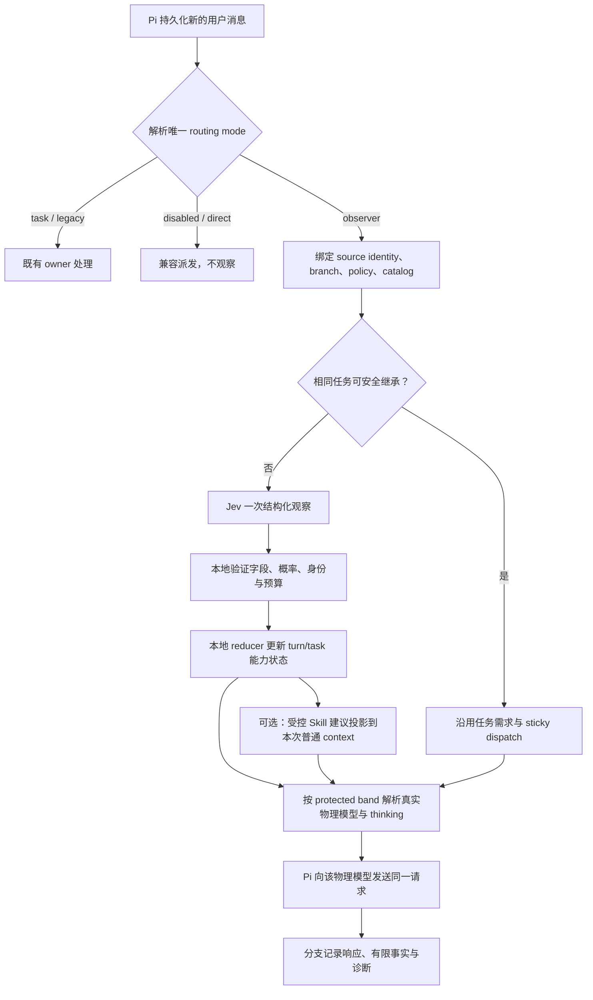
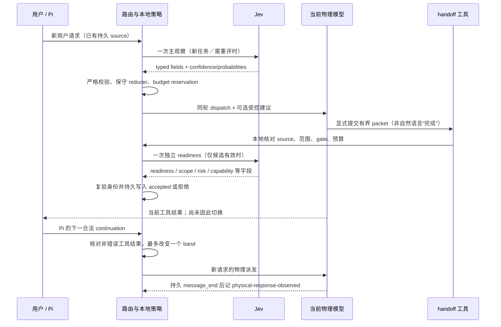

# pi-gear-router

为 [Pi](https://pi.dev) 提供按用户任务动态切换的三档模型路由，由 [TypeSafe Jev](https://typesafe.ai) 评估当前请求。

新版本提供显式 opt-in 的**会话观察／引导与能力路由**，不再把它等同于统一开发流程。默认仍保留 task 模式，旧 workflow 仅在 legacy owner 下生效；本扩展不会替你改个人配置。

在 Pi 中选择虚拟模型 `gears/auto`，路由器会维护**当前任务下一步工作的能力需求**。实质性新要求需要评估；明确的纯文本“继续”可有限继承已有模型和 thinking，不把短句误当成简单任务。独立新任务清空旧任务难度。同轮普通工具跟进与失败重试保持实际派发；observer 只在显式能力交接后的合法请求边界可切换。

Jev 输出连续 `0..2` 分数，路由按五个区间同时选择模型档位和 thinking level：

| 调整后分数 | 模型档位 | thinking level |
|---|---|---|
| `0.0 ≤ score < 0.5` | light | high |
| `0.5 ≤ score < 1.0` | standard | medium |
| `1.0 ≤ score < 1.5` | standard | high |
| `1.5 ≤ score < 1.8` | heavy | high |
| `1.8 ≤ score ≤ 2.0` | heavy | xhigh |

上表是默认映射，可用 `bands` 覆盖；模型选择仍是三档，分档用于控制分数区间与思考深度。区间边界取左闭右开，最后一段包含 `2.0`。

## 为什么分三档

只在便宜和昂贵模型之间选择，会把常规重构、调试和实现工作挤进两个不合适的档位。中间档承接大部分工程任务；昂贵模型留给确实需要更强能力的请求。

分类器评估的是“能正确完成本次任务的最低能力档位”，而不是笼统的“这个话题有多难”。近期对话仅用于理解指代和后续意图，独立的新任务不应继承上一轮的难度。

## 设计起因与目标

路由器最初解决的是“每轮选哪档模型”。单轮评分容易把短句「继续」误认为简单工作，也容易把复杂任务中的「解释一下」永久降成低能力需求；同一任务的持续需求、当前回合要做的事、物理模型实际上派发到哪里，必须分别记录。

更早的可行性样本还暴露出另一个问题：分类器能够识别 review/planning，但旧的统一置信门槛和工作流启动条件仍可能阻止合理的只读审查。由此，新设计把范围收窄为**会话观察＋能力路由**：让快速 Jev 理解最新消息与任务背景，由本地代码执行确定性的连续性、置信门槛和预算规则；给主模型的 Skill 提示是建议，不是另一个流程指挥者。

设计遵循四条边界：

1. **一个结构化观察请求，而非聊天模型级联。** 主要用户回合由 Jev 一次多问题 classify；能力交接候选才有一次独立 readiness，不串聊天模型作第二判官。
2. **建议、能力和权限分离。** `converge/implement/verify/respond` 描述所需能力，不代表方法阶段或操作许可。项目、用户、已选 Skill、Pi 和权限扩展仍决定方法、审批与实际工具权限。
3. **在请求边界切换，不抢占运行中的工作。** 普通 tool continuation 与 retry sticky；同一 run 要换能力，需有界交接、本地接受记录和下一合法 continuation。accepted、consumed、physical response 是三件不同的事。
4. **未知时保守降级，不伪造覆盖。** source、资源目录或事件不可验证时不据此降档／注入过期建议；严格概率无效与有效低置信分别处理。预算失败不阻止正常主模型回答。

observer 尚未启用时，项目仍按现有 task owner 路由；`workflow` 旧实现只在互斥的 legacy owner 下生效。**设计获批、代码已接入、个人默认启用是不同状态**：本 README 描述 observer 功能，但不会修改用户设置或自动启用它。

## 系统如何运行

下面展示一次普通用户请求。关键是观察与物理派发发生在同一个请求边界：没有额外 user turn，注入的 Skill 内容也不会自动读取。



### 请求边界与换档交接

主模型可显式调用 `gear_capability_handoff` 提交有界工作材料。这个过程只回答“下一请求需要什么能力”，不批准实施或推进项目方法。工具校验、readiness 与下一次 continuation 分开执行：



retry 不消费 handoff，输入、session/tree/mode/catalog 变化使 pending 建议失效。实际物理 pair 可能受模型可用性与 thinking 支持裁剪；状态同时保留 protected demand 和实际派发，不把 fallback 说成达到了原能力。

## 实现结构

Pi 扩展入口只接生命周期、route 和 UI；领域规则集中在可独立验证的模块中。主要调用关系是 **Pi adapter → 纯契约／策略**，分类器 adapter 是唯一外部结构化判断依赖。

| 文件 | 职责 | 明确不拥有 |
|---|---|---|
| `src/index.ts` | 注册 `gears/auto`、解析 mode、连接 Pi 事件、派发与状态栏／命令 | 意图判断、开发流程、工具权限规则 |
| `src/observer-runtime.ts` | 绑定 source identity、目录快照、branch events、context、调用 owner 与生命周期 | 第二套方法阶段机或权限审批 |
| `src/observer-routing.ts` | 有界 JSON/schema、严格概率 parser 辅助、预算状态及 task/turn/profile reducer | 网络请求、文件系统和 Pi UI |
| `src/observer-judge.ts` | Jev typed questions、field-level 校验、deadline/abort/retry、usage accounting | 自由文本判官、聊天 cascade、授权决定 |
| `src/observer-guidance.ts` | runtime Skills 候选、有限输入、受控模板和 request-local projection | 扫描个人目录、读 Skill 正文、强制采用 |
| `src/observer-handoff.ts` | `gear_capability_handoff` schema、本地 gate、readiness 接线与持久接受 | 项目批准、文件修改、业务完成 |
| `src/observer-status.ts` | 从 validated state/current branch 产生安全的简短状态和详情 | classification、持久化、路由变更 |
| `src/gears.ts`、`src/observation.ts` | 复用物理模型解析／fallback；记录有限公开 branch facts | 把事实推断成全面验收或权限 |

持久状态与审计事件跟随当前 session branch。主要状态记录任务 anchor、source identity、观察字段、能力请求/保护值、dispatch、预算和有界引导；事件分别记录 classifier reservation/result、公开执行事实以及 handoff 生命周期。读取/恢复必须核对来源，不能从 abandoned branch 拾取“补充”授权。

### 故障与安全边界

- Jev timeout、服务不可用、invalid probability、missing field 和有效低置信是不同结果。概率不归一化，choice 总和容差保持 **0.001**；格式错误不包装成“意图不确定”。
- 联网前先持久 reservation；取消或失败不返还 logical call。超时之后的迟到 usage 只可为原来源记账，迟到答案不能改变路由或接受交接。
- prompt / Skill 元数据预算限制外发量，但不是秘密脱敏。Skill path 和正文默认不发送；用户内容与 description 仍可能含敏感信息。
- 任意 Skill 中未公开的审批 gate、服务 confidence 的真实校准、大目录语义召回及跨供应商 cache/cost 收益均未被保证。应结合 Pi 项目权限和自己的方法指引使用。

更完整的字段契约与决策基线见[已批准设计](.kiro/specs/observer-guided-routing/design.md)；模块测试、线上合成证据及未证实限制见[验证记录](docs/observer-guided-routing-verification.md)。

## 安装

需要 Pi 1.1.0 或更高版本，以及模型供应商的有效凭据。

```sh
export TYPESAFE_API_KEY="apikey_..."
pi auth check --provider typesafe
pi install /path/to/pi-gear-router
pi --model gears/auto
```

Pi 已内置 `typesafe/jev-latest` 分类器目录项，不需要单独在 `models.json` 注册。

若要默认选用路由，在 `~/.pi/agent/settings.json` 中设置：

```json
{
  "defaultProvider": "gears",
  "defaultModel": "auto",
  "enabledModels": ["gears/**", "yourprovider/**"]
}
```

`enabledModels` 会过滤启动及模型轮换列表。如果已经配置它，需要将 `gears/**` 加入现有列表，不要直接覆盖其他配置。

## 配置

创建 `~/.pi/agent/pi-gear-router/settings.json`（支持 `//` 与 `/* */` 注释；完整带注释示例见仓库根目录 [`example.settings.json`](example.settings.json)）：

```json
{
  "enabled": true,
  "gearBias": 0,
  "bands": [
    { "max": 0.5, "gear": "light",    "thinkingLevel": "high" },
    { "max": 1.0, "gear": "standard", "thinkingLevel": "medium" },
    { "max": 1.5, "gear": "standard", "thinkingLevel": "high" },
    { "max": 1.8, "gear": "heavy",    "thinkingLevel": "high" },
    {               "gear": "heavy",    "thinkingLevel": "xhigh" }
  ],
  "judgeTimeoutMs": 15000,
  "taskRouting": {
    "maxInheritedTurns": 3,
    "downgradeWindow": 2,
    "downgradeMargin": 0.08,
    "minConfidence": 0.8
  },
  "workflow": {
    "enabled": false,
    "planningMinBand": 3,
    "executionMinBand": 1,
    "atomicExecutionMinBand": 0,
    "verificationMinBand": 1,
    "recoveryMinBand": 3,
    "handoffMinConfidence": 0.8,
    "maxTransitions": 6,
    "maxReminderContinuations": 1
  },
  "gears": {
    "light":    { "provider": "yourprovider", "model": "cheap-model-id",    "thinkingLevel": "high" },
    "standard": { "provider": "yourprovider", "model": "balanced-model-id", "thinkingLevel": "medium" },
    "heavy":    { "provider": "yourprovider", "model": "frontier-model-id", "thinkingLevel": "high" }
  }
}
```

三个档位可以跨供应商，但应按实际能力递增配置。`src/defaults.ts` 提供 Anthropic Haiku / Sonnet / Opus 的通用默认值，以及本地 Magpie 网关的示例配置。

配置文件缺失、JSON 损坏或部分字段不合法时使用默认值。目标的 provider/model 不能为空；thinking level 允许 `off`、`minimal`、`low`、`medium`、`high`、`xhigh` 和 `max`。最终等级还会按物理模型支持的范围裁剪。

配置按文件元数据缓存，修改后在下一次路由调用时重新读取；返回值彼此隔离，不共享可变默认对象。本轮已选定的物理模型不会因为配置文件被修改而在工具跟进中变化。

### 项目级配置

除用户级文件外，可在项目里放 `<项目根>/.pi/pi-gear-router/settings.json`，与用户级配置按字段合并：项目文件里出现的字段覆盖用户级，未出现的继承用户级；`gears` 按档位合并，`bands` 数组整体替换；非法字段回落到用户级值。修改后同样在下一次路由调用时重新读取。

task／legacy 的既有 overlay 行为保持兼容。涉及 observer 模式时，**所有项目级 router overrides 都要求 Pi 的 `ctx.isProjectTrusted()` 为 true**；缺少该能力不算信任。信任只控制配置来源，不是工具权限或内容安全过滤器。

### `enabled`

默认 `true`。设为 `false` 时不调用 Jev：优先沿用最近实际使用的物理模型及 thinking level，没有历史模型时使用 `standard`（不可用时再尝试其他配置档位）。

这不是恢复“之前手动选中的模型”的操作：当前选择仍是 `gears/auto`。如果要完全退出虚拟模型路由，请用 Pi 的 `/model` 选择物理模型。重新启用后，新的用户请求会重新评估。

### `bands`

分档表，决定「调整后分数 → 档位 + thinking level」。有序数组，下标即能力区间；前 N-1 项必须带 `max`（升序、位于 `(0,2)`），最后一项省略 `max` 并兜底到 `2.0`。长度 1..16。

省略该字段时使用默认五档。任一项非法时整表回退默认值，不做部分生效。修改分档表属于配置变更，会让下一次用户回合重新评估；已冻结的同轮派发不变。`gear` 仍须是 `gears` 中配置的 `light`/`standard`/`heavy`。

### `gearBias`

在原始分数上增加 `gearBias × 0.4`，再将结果限制在 `0..2`。然后按分档表一起选择模型档位和思考深度：

| 值 | 效果 |
|---|---|
| `-1` | 最多降低 0.4 分，更偏向低成本档位 |
| `0` | 不调整分类器结果 |
| `+1` | 最多提高 0.4 分，更偏向高能力档位 |

这不是强制所有任务进入某一档。轻任务经常进入 standard 时可以试 `-0.3`；困难任务被低估时可以试 `+0.3`。

### `judgeTimeoutMs`

默认 15 秒。分类调用会增加首 token 前的等待时间；超时会降级，不阻塞同一轮的后续工具调用。实际延迟取决于分类器服务。

### `taskRouting`

| 参数 | 默认 | 合法范围 | 用途 |
|---|---|---|---|
| `maxInheritedTurns` | 3 | 整数 0..10 | 连续免评估回合上限；第四次续接重新评估 |
| `downgradeWindow` | 2 | 整数 2..8 | 降档所需的近期可信、不同上下文样本数 |
| `downgradeMargin` | 0.08 | 0..0.15 | 降档目标边界的保护裕量 |
| `minConfidence` | 0.8 | 0.5..1 | 评分及关系确认门槛，不等同于准确率 |

省略时用默认值，无效字段逐项回退。`maxInheritedTurns: 0` 关闭跨轮免评估，但保留窗口降档保护。

只有有效任务、可用且未降级的保存派发、相同配置和无待重评原因时，以下完整纯文本可继承（允许一个结束标点，忽略首尾空格和大小写）：

```text
继续 / 继续吧 / 继续处理 / 继续处理这个问题
按刚才的方案继续 / 按这个方案继续 / 按方案继续
continue / please continue / go on
```

“好的”“谢谢”“继续，另外增加权限校验”、图片附件、不明确指代不命中继承。继承不产生新评分或窗口样本。分类失败、低置信度、关系不明、配置改变、验证失败、结项提示、手动模型 gap 或观测缺失需要重评。

有任务背景时，同一次 Jev 请求评估 `gear` 和 `relation`（同任务 / 新任务 / 不确定）。同任务的新高需求立即升级；降低必须有满窗口：先取原始分数最大值，应用一次偏置，再加降档裕量，最后映射目标区间。独立新任务直接按新需求选档。关系不明时取旧承诺能力和新需求的较高者，仅作为本轮临时派发。

相同上下文重复低分不能推进降档；提前复核仍没有新证据时，保留高档并退回有限继承，避免每轮无限重复问 Jev。去重最多保留 32 个 key，样本最多 8 个，不保证无限历史或统计独立性。

#### `minConfidence` 与「关系不明」

`minConfidence` 同时是**评分可信门槛**和**任务关系可信门槛**。关系判定要成立必须同时满足：Jev 的回答格式合法、未选择 `uncertain`，且关系置信度与所选标签的概率都不低于该阈值。

任一条件不满足时 footer 显示「关系不明」，路由取**旧承诺区间与本轮评分区间的较高者**作为本轮临时派发，并标记任务待重评；不确定的新分数不并入已确认历史。所以「关系不明」不等于 Jev 说了 `uncertain`，也可能只是置信度或概率不足。

调节方向：

- **调低**（如 `0.6`）：关系更容易被采信，「关系不明」与重复重评减少，降档更快；代价是可能把独立新任务误判为旧任务而继承旧难度，或把旧任务误判为新任务而误降档。
- **调高**（如 `0.9`）：更保守、误判更少，但「关系不明」与重评更频繁，降档更慢。
- 它也作用于评分：调低会让置信度较低的分数也进入降档窗口与承诺区间。

关系判定只在已有任务上下文时进行；没有旧任务时不会出现「关系不明」。

### `routingMode` 与 observer（显式 opt-in）

```json
{
  "routingMode": "observer",
  "workflow": { "enabled": false },
  "observer": {
    "guidance": { "enabled": true, "maxCandidates": 2, "maxChars": 800, "maxPerTask": 6 },
    "skills": { "enabled": true },
    "stageAware": true,
    "minBands": { "converge": 3, "implement": 1, "verify": 1, "respond": 0 },
    "maxCallsPerTask": 24,
    "maxTransitions": 4,
    "maxTransportRetries": 0
  }
}
```

唯一 owner 的选择规则：

| 配置 | owner |
|---|---|
| `enabled:false` | disabled，不观察 |
| 未指定 mode，workflow 关闭／开启 | task／legacy-workflow |
| `routingMode:"observer"`，workflow 关闭 | observer |
| `routingMode:"task"` 或 `"observer"`，但 workflow 开启 | legacy-workflow，并提示 mode-conflict |
| `routingMode:"legacy-workflow"` | legacy，包括旧 guard/reminder/complete，即使旧 enabled flag 为 false |
| 非法 mode | 按旧 workflow flag 回退并诊断，不继承 observer opt-in |

observer 使用 `typesafe/jev-latest` **一次多问题 classify**识别消息作用、任务关系、下一工作及 Skill 候选。它不是能执行工具的第二个 agent，也没有聊天 LLM cascade。`converge/implement/verify/respond` 是能力状态，不是方法阶段或修改授权。设计、需求收敛、复杂调查／诊断使用高能力下限；简单问答不强制 heavy。解释当前结论可临时 respond，但 taskBand／方法背景不重置；之后真实继续恢复持续需求。

- 明确纯继续最多免观察 3 个用户回合；observer 白名单为 `继续/继续吧/请继续/continue/go on/proceed`（尾部句号／感叹号、大小写可忽略）。批准、引用和附加范围不走继承捷径。
- 持续降档默认需要 2 条不同 source/evidence 的可信观察和 0.08 margin；未知关系不覆盖任务 anchor，dirty／审批等待／未知风险不能支持降档。相关语义门槛固定 0.80，不受 legacy 的 `handoffMinConfidence` 调整。
- `guidance.enabled:false` 只停止 Skill／澄清建议，**不会停止观察**。`skills.enabled:false` 停止候选元数据外发；显式选择的 Skill identity/name 和用户附带请求仍可能参与任务解释。`stageAware:false` 不用 profile floors 或能力交接，仍保留 task-aware 保护。
- 每次最多 2 个建议、800 Unicode 字符／2 KiB，同任务/effect/work/catalog/candidates 去重，默认每任务 6 条。忽略建议不会被催促、加载正文或强制继续。推荐、观察到读取、显式展开与“是否遵循未知”分别记录。
- Skill 目录只来自 Pi 当前运行时资源，不扫描个人目录；explicit-only、重名、不可读、不在当前可见清单的 Skill 不自动推荐。大目录按 Latin 词／中文双字重叠有限召回，至多 12 候选、description 384 字符、元数据 6,000 字符；零匹配不随机补齐。这不是完整召回保证。

#### 显式能力交接

`gear_capability_handoff` 默认 inactive、sequential，只在 observer＋stageAware＋gears/auto 下启用；SDK 的工具 allowlist 若排除它，不会绕过宿主限制。受控上下文只提供 packet 关联所需 task/source ID，不制造新用户消息。

主模型可提交 v1 有界 packet（字段见[设计 §7](.kiro/specs/observer-guided-routing/design.md)）：目标、scope、决定、步骤／acceptance、约束、validation、风险、blockingUnknowns、methodGate 和真实 user 引用。文本 ≤1,000 字符，列表／steps ≤8、acceptance ≤4，总量 ≤8,000 Unicode／16 KiB；不接收任意 provider/model 或 complete。

本地来源与门禁、一次独立 Jev readiness、再次 identity 复验及 accepted event 持久化均通过后，**仅下一合法工具 continuation**可以消费。工具结果被权限扩展拦截／替换为错误不能消费；retry 永不消费。每次同 run 降档至多一个 band、受 target floor／风险保护，接受后至少 2 个新实质观察冷却；默认每任务最多 4 次转换。accepted、consumed、actual response 是不同事实；同模型只改变 thinking 也可能是一次转换。

readiness **不批准实施或方法阶段**，`none_observed` 不是审批证明，packet 不能清掉旧等待。用户、项目、已选方法、权限扩展和运行环境仍负责授权与安全；未公开的任意 Skill gate 不能保证检测。旧 workflow accepted／complete 不转换成新协议。自然结束、没有读 Skill 或没有 handoff 均不产生 reminder 或新回合。

#### 预算、恢复与隐私

两类 classify 共用每任务默认 24（硬上界 64）逻辑 calls，联网前持久 reservation；失败／取消不返额度。transport retry 默认 0、最多 1，总 deadline 15 秒包含 auth/transport，不叠加 provider retry。预算耗尽仍可正常回答并保持 dispatch；reload/resume 不重置，需要明确新 session 或手动调整路由。branch/tree/reload 保留已消费能力／预算／去重，但不恢复 pending acceptance 或旧建议。源定位不足省略建议；compaction carry 仅保留 ≤2,000 字符／4 KiB 工作材料，不是阶段命令。

**外发 TypeSafe 的数据**：最新 request（≤16,000 Unicode）、有界 task anchor/changes、最近公开 assistant 文本、有限方法／控制／执行事实、运行时 Skill name/description（启用时）、能力交接 packet。总体 ≤32,000 Unicode／64 KiB。Skill 路径仅本地验证；不默认发送正文、system、hidden thinking、图像数据或完整工具输出。用户正文／description／packet 仍可能含秘密，**截断不是脱敏**，启用前应自行评估。诊断不保存原始服务异常或凭据；usage 缺失／目录 cost=0 不代表免费，也不保证 cache 命中或省钱。

状态使用独立 `observer-routing` v1 schema 与两个 v1 event namespace。TUI 使用紧凑路由状态；print/RPC 不写终端状态栏，保留结构化 state/events。RPC 的显式 `/gear-status` 可使用其通知协议，不是终端组件。验证证据与限制见[observer 验证记录](docs/observer-guided-routing-verification.md)。

### observer 状态栏与只读详情

不修改 Pi 核心，也不替换原生 footer；通过 `ctx.ui.setStatus("pi-gear-router", …)` 添加本扩展状态，保留原生 token/费用/上下文及其他扩展。模型与thinking放在前面，窄终端由 Pi 按显示列宽截断。

```text
路由 收敛 → gpt-6.1-sol · high ｜ 能力保护 ｜ Jev 1/24
路由 实施 → gpt-6-luna · high ｜ 交接已生效 ｜ Jev 2/24
路由 解释 → space-bunny-free · low ｜ 临时降档 ｜ Jev 3/24
```

这里“实施”只是能力profile，不是实施批准。异常优先提示额度耗尽、目标/thinking回退、方法等待、交接证据不足、超时、格式无效或事件覆盖不足；不把格式valid显示成判断可信，不用整行绿色暗示业务成功。评估中显示pending，沿用的模型是最近记录，不表示新评估已完成。

输入 `/gear-status` 查看多行只读详情：本轮/持续任务能力、请求→保护band、完整实际provider/model/thinking、交接接受/消费/响应、调用与attempts/转换/引导预算、字段confidence/probability、Skill建议数/读取/显式展开/遵循未知、覆盖和usage是否报告。没有可验证的Skill name映射时只显示候选数量，不从guide文字解析名称。原始请求、Skill正文、工具输出和自由诊断不进入展示。price=0不代表免费。

命令不调用Jev、不追加会话entry、不创建用户回合或修改设置。详情从当前branch状态和有限events重建；accepted不保证reload后仍可消费，consumed不等于实际响应。手选模型、observer关闭或无状态时清除旧观察显示；task/legacy原显示保持兼容。print/JSON模式不访问UI，TUI及RPC通知支持命令。此次展示验证见[状态栏验证记录](docs/observer-statusline-verification.md)。

### `workflow`：legacy 阶段编排（显式 opt-in）

默认 `workflow.enabled: false`。关闭时保持既有 task-aware routing 的判定、跨用户回合继承、同轮 sticky dispatch 与 fallback 行为；不会额外调用 workflow Jev questions，也不会注入工具或自动 continuation。

启用后仅对 Jev 的 objective/start/clarity/risk 与置信度均通过严格校验的**文本**请求启用阶段控制。`deliver` 可以自动推进阶段；`plan_only` / `research_only` 最多保留只读 planning，不会自动进入 execution：

1. **planning**：设计、调研或高风险/不明确的交付请求从至少 `planningMinBand` 开始。该阶段是只读的。
2. **execution**：范围明确、低风险的直接工作可从 execution 开始；其余只能由已接受的 `planning → execution` 或 `recovery → execution` handoff 进入。默认至少 `executionMinBand`；只有高明确、低风险且有完整 scope/acceptance 的 atomic 工作才可降至 `atomicExecutionMinBand`。
3. **verification**：只由 execution handoff 进入，默认至少 `verificationMinBand`。支持的验证命令会仅记录 workflow ID、turn ID、结果和命令类别；不会写入完整命令或输出。
4. **recovery**：设计假设失效或复杂诊断由 accepted recovery handoff 进入，至少 `recoveryMinBand`，同样只读。
5. **complete / blocked**：completion 需要同一 branch/workflow 的当前 active user turn 中**最后一条**结构化 validation fact 为 `passed`，且 completion packet 不含 remaining issues。达到 `maxTransitions`（包括一条尚未消费的 accepted handoff）或用完一次缺交接提醒后，工作流记录为 `blocked`，不会无限续接。

planning/recovery 的 `tool_call` guard 会阻止 `edit`、`write`、未知/MCP 副作用工具以及无法严格证明只读的 `bash`/`powershell`。它只放行 Pi 的读取工具、`gear_workflow_handoff`，或明确标记 `readOnlyHint: true` 且不 destructive/open-world 的工具。shell 只允许独立的 `pwd`、有限 `ls`、路径-only `find`、有限 `rg`/`grep` 和只读 `git status|diff|log|show`；管道、重定向、命令连接、变量/子 shell、`find -exec/-delete` 和未知选项一律拒绝。进入 execution 后本特性不再增加工具限制，Pi 原有权限流程仍生效。

模型只能通过 `gear_workflow_handoff` 提交有界 JSON packet；自然语言的“计划完成”或“开始实现”没有换模型权限。工具会本地校验 packet/phase/budget，并用一次独立 Jev readiness 判定校验 `delivery`、`readiness`、`risk`、`capability`。只有 accepted event 会让**紧接的** continuation 切换 physical pair；reducer 还会复验 confidence、packet blocker 与 completion evidence。普通 tool continuation 与所有 retry 都保留实际 physical model/thinking pair。用户的新消息优先于未消费 handoff，并重新判定；手选模型切换也会使未消费 handoff 失效；accepted packet 是工作材料，不会压过最新用户请求。

planning/recovery 在自然完成且没有 accepted/rejected handoff 时可自动追加一次隐藏 reminder continuation；第二次缺失会写入 `blocked` 而停止。error、abort、pending user message、plan-only/research-only、已接受或已拒绝 handoff 不触发 reminder。

| 参数 | 默认 | 合法范围 | 用途 |
|---|---:|---:|---|
| `planningMinBand` | 3 | 当前 `bands` 的有效下标 | 只读规划下限 |
| `executionMinBand` | 1 | 同上 | 普通执行下限 |
| `atomicExecutionMinBand` | 0 | 同上 | 原子执行下限，不是全部执行默认值 |
| `verificationMinBand` | 1 | 同上 | 验证下限 |
| `recoveryMinBand` | 3 | 同上 | 只读恢复下限 |
| `handoffMinConfidence` | 0.8 | 0.5..1 | handoff readiness 门槛 |
| `maxTransitions` | 6 | 整数 1..8 | 单 workflow 已接受转换上限 |
| `maxReminderContinuations` | 1 | 0 或 1 | planning/recovery 自动提醒上限 |

阶段切换是正确性边界，不是 cache 优化。它可能使下一物理模型请求重新建立 prompt cache；本扩展没有、也不声称有跨物理模型的 KV/cache 迁移能力。能力要求、风险和 handoff 验证优先于任何未验证的 cache affinity。

### thinking level

选择 `gears/auto` 时，thinking level 由请求能力区间决定：可能是本轮判决、窗口保护后的承诺能力或可信继承，而不总等于最新评分的直接映射。Pi 的 `/thinking` 不覆盖自动路由；手动选择物理模型时仍使用 Pi 原生行为。配置的 `thinkingLevel` 用于没有有效判决、没有保存等级或 `direct` 等后备情况；已有请求等级会传给降级候选，再按实际模型支持范围裁剪。工具跟进和重试沿用实际派发等级。

## 路由时机

| 场景 | 是否评估 Jev | 行为 |
|---|---|---|
| 实质性新用户请求，包括 steering / follow-up | 是 | 评估任务关系与下一步能力，按保护规则调整 |
| 满足条件的纯文本续接 | 否 | 保持实际模型/等级，最多连续继承三轮 |
| 到期或需要复核的续接 | 是 | 一次评估；不因重复低分制造降档证据 |
| 同一用户请求重复进入路由 | 否 | 复用已保存的判决与物理模型 |
| 工具结果后的继续生成 | 否 | 优先沿用最近成功回复的实际模型和等级 |
| 失败重试，包括上下文溢出恢复 | 否 | 优先沿用失败请求的实际模型和等级 |
| 无历史模型、无状态的孤立 continuation / retry | 尝试一次 | 判断后保存结果或兜底 |
| 压缩摘要、扩展直接模型调用 | 否 | 启用时走 light，不写入本轮状态 |
| 路由被禁用 | 否 | 沿用历史模型，无历史时使用 standard |

路由状态写入当前 session 分支的 `pi.virtual-model-state`。去重依据用户消息的稳定 entry ID 和内容摘要，不依赖消息数量；没有 session entry 的 SDK 调用使用消息时间戳和内容摘要。因此压缩、恢复和 `/tree` 导航本身不调用 Jev；新用户回合再判断能否继承。旧版本没有有效 task 时重建任务，旧同轮派发仍可使用。任务状态随当前分支恢复，不从其他分支寻找替代。

成功判决和分类失败的兜底都会保存，避免 Jev 超时后在每次工具跟进中反复调用。保存内容包括：

- `turnId`：本次用户回合标识，与跨轮 `task.taskId` 不同；
- `gear`：最终选择的档位；
- `dispatch.thinkingLevel`：本次分数区间最终选择的 thinking level（或物理模型支持等级裁剪后的值）；
- `score` / `adjustedScore` / `confidence`：分类结果；没有有效结果时分数为 `-1`、置信度为 `0`；
- `inputTokens`：有效判决报告的输入 token 数；无有效判决时为 `0`，不代表失败调用一定没有产生费用；
- `fallback` / `fallbackReason`：是否兜底及原因；
- `dispatch`：实际物理模型与 thinking level，供同轮复用；
- `task`：版本化、有界任务锚点、承诺能力、窗口、继承计数和分支观测 cursor；
- `decision`：判决/继承/兜底来源、关系、触发原因、请求区间、保护分数和分类失败原因。

`gear` 是实际档位，`decision.requestedBand` 是所需能力；物理目标不可用或等级裁剪不会改写任务需求。`score` 是最新真实评分，hold 时不伪造旧高分。继承沿用原分数和来源，本轮 `inputTokens=0`。

### 失败与降级边界

- 分类器缺失、缺少密钥、超时或结果无效：已有上一轮派发记录时优先保留该物理模型，否则使用上一轮档位或 `standard`。下一次新的用户请求再尝试 Jev。连接失败（`fetch failed`）不受 Pi 的 provider 重试覆盖（该重试只处理带 HTTP 状态码的错误），因此在本插件的传输层于同一 `judgeTimeoutMs` 窗口内有界重试（最多 2 次、指数退避）。失败原因（`stopReason`／错误摘要）写入 `decision.judgeFailure` 并显示在状态栏，便于区分超时、代理或鉴权问题。
- 目标模型不在目录、没有配置凭据或是另一个虚拟模型：依次尝试 `目标档 → standard → light → heavy → 历史物理模型`，重复档位只检查一次。
- 所有候选都不可用：抛出包含真实配置路径的错误；没有可用物理模型时无法继续生成。
- 已配置凭据不保证远端服务可用。实际 provider 网络错误、限流等由 Pi 的请求及重试机制处理，本扩展没有实现自动故障转移或同轮升级。
- 用户取消请求时尊重取消，不将取消变成新的 fallback 判决。

## 选择模型

不能仅凭价格认定一个模型适合 light 档。强推理的便宜模型在高 effort 下可能耗尽预算却不输出答案。light 档默认请求 `high`，与五个能力区间一致；请用真实任务验证所选模型，必要时在 `settings.gears.light` 中把 thinking level 调低。

`src/defaults.ts` 记录了本地 Magpie 网关的八项任务测量：space-bunny-free 在 high 下曾耗尽输出预算，在 low 下回答正常；Luna 与 Sol 都通过任务，但延迟不同。该测量只说明那次网关测试的表现，不代表通用模型排名或路由效果保证。

## 设计与限制

基于 Pi 的 [虚拟模型机制](https://pi.dev/docs/latest/virtual-models)，而不是 `before_agent_start` 中全局调用 `pi.setModel()`。Pi 保持虚拟选择，实际模型只作用于当前请求；原生 footer 显示选择与派发，例如：

```text
(gears) auto • high → zies/gpt-6-luna • high
```

状态栏通过 Pi 的 `ctx.ui.setStatus()` 追加到原生 footer，不会覆盖其他扩展。支持新判决、周期评估、降档复核、`沿用 Jev 1.92 · 续接 2/3`、降档保护、关系不明及 fallback。会话启动和 tree 导航恢复对应分支结果，关闭时清除显示；仅 TUI 使用 UI。Jev 返回分数与置信度，不展示内部推理过程。

workflow 启用后，已有有效阶段显示 `工作流 planning/execution/verification/recovery/complete/blocked`；没有建立阶段时仍保留能力评分和任务关系，同时显示原因，例如：

```text
Jev 1.04 · 关系不明 · 工作流未启动：置信度不足（0.69<0.80） → standard/high → magpie/zies/gpt-6-luna
Jev 0.76 · 工作流不适用：审查请求 → standard/medium → …
```

还可显示分类不可用、分类不完整、非文本输入、无需阶段编排或直接执行条件不足。置信度数字是该回合 workflow 语义 choice 的最低 confidence/probability 与实际使用的门槛，**不是** Jev 能力评分。旧回合没有诊断记录时显示 `工作流待评估：新请求生效`；reload 不会凭空补判旧回合原因。诊断以固定原因标签和有限数值保存，不记录请求正文或工具输出，也不授权阶段切换；workflow 关闭时维持原有显示。

思路参考 MIT 项目 [pi-gearshift](https://github.com/iharuya/pi-gearshift)，保留最低能力档位的判题目标与偏置方式，但使用 Pi 内置 `classify()`，不额外依赖 TypeSafe SDK。

已知限制：

- 关系识别仍可能错误。有限继承是保守白名单，不是完整语义识别；初值尚未按真实轨迹校准。减少分类次数不保证总费用下降，保护高档可能更贵。
- 公开分类输入最多包含当前请求 16,000、任务锚点 4,000、近期变更 3,000、三条助手文字合计 3,000 个 Unicode 字符。字符预算不等于 token 上限或秘密脱敏；不发送 thinking、原始工具输出/参数、图片数据。纯图兜底，图文不获得免评估资格。
- 执行观测只识别明确 Bash 验证失败及其嵌套事件，命令需为允许的 npm/pnpm/yarn 验证脚本或 `npx tsc --noEmit`。复杂 shell、缺少退出码或不一致 metadata 不推断失败。marker 仅存任务/回合和失败类型，不存命令、路径或输出；执行失败只触发下一用户回合重评，不直接升级。
- 第一版仅维护当前任务，不提供任务栈或同轮升级。没有事件/append 能力的 SDK adapter 或观测写入失败会保守重评，不能声称完整执行监测。
- SDK 消息未落入 session 时，时间戳和内容均相同的请求无法区分；常规 Pi session 使用独立 entry ID。
- 不提供价格表、节省金额统计或分类器费用核算。状态中的 token 数只用于诊断。
- 档位切换可能损失 provider 的 prompt cache；同轮固定模型有助于缓存和 thinking 签名兼容，但不保证跨轮缓存命中。workflow 的 accepted phase switch 明确接受这一 cold-cache 成本，且不代表跨模型 KV 复用。

## 开发与验证

```sh
npm install
npm run typecheck
npm test
```

测试使用 Node 内置测试框架和原生 TypeScript 支持，需要 Node 22.18+ 或其他默认支持 TypeScript stripping 的版本。测试不请求真实 Jev 或物理模型服务；包含实际 Pi `SessionManager` 的压缩和分支状态测试，配置写入临时目录，不修改个人 Pi 设置。

### observer 有界真实验证

```sh
# 默认仅输出计划，不联网；不由 npm test 执行
node test/live-observer-smoke.mjs
# 仅在当时已获用户联网许可时手动执行
node test/live-observer-smoke.mjs --run
# 受限合成 reader，让 runtime Skill 清单可见；结果独立保存
node test/live-observer-smoke.mjs --run --visible-catalog
# 当前能力锚点与预算连续性复验，独立报告
node test/live-observer-smoke.mjs --run --budget-fix
# 评分锚点专项诊断；默认仅离线重放历史结果
node test/observer-capability-diagnostic.mjs
```

脚本公布合成 fixture、模型、calls/attempts/deadline/输出上限，临时复制认证并清理；不发送真实用户任务或加载个人 Skills。真实语义、概率失效率、handoff 和物理路由分别报告，不用 mock labels 当真实准确率。历史smoke的失败／partial保留；最终有界合成轨迹已验证handoff接受、消费、实际响应及预算连续性（见[专项诊断](docs/observer-capability-diagnostic.md)），不代表通用准确率、gate覆盖或费用保证。脚本未满足验收时退出非0。legacy 保留，不预定静默退休日期。

### 历史 task／legacy 真实服务联网验证

手动运行（不包含在 `npm test` 中，会产生真实 API 用量）：

```sh
node test/live-smoke.mjs --run
# 只验证普通功能实现任务：
node test/live-smoke.mjs --run --standard-only
# 复杂任务 → 续接 → 同任务阶段变化 → 独立新任务：
node test/live-smoke.mjs --run --task-aware
```

脚本使用个人 Pi 的模型配置与凭据，在临时目录复制凭据与路由设置，创建内存会话，只启用 read 工具。每轮限时、模型输出最多 6,000 tokens，禁用自动重试和缓存预热。结束后删除临时凭据，保留不含密钥的诊断报告。测试检查新用户任务调用次数、派发状态、非空模型响应和工具跟进的一致性，不评估生成代码的完整正确性。

历史联网结果见 [联网验证记录](docs/live-verification.md)，它们早于任务感知算法，不能作为新策略的真实准确率或费用证明。本次任务感知实现只做离线验证，见 [实现验证](docs/task-aware-routing-verification.md)。

## 许可证

MIT，见 [LICENSE](LICENSE)。
